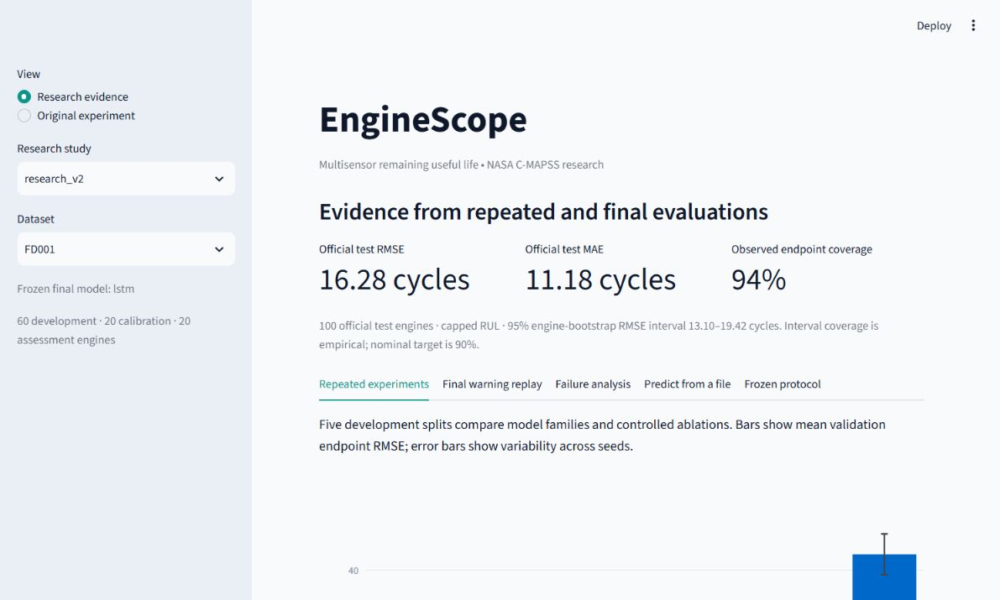

# EngineScope sensor fusion for remaining useful life

This project studies whether combining sensor histories improves remaining useful life (RUL) estimates for simulated turbofan engines. It compares classical regressors with LSTM and GRU models, investigates individual sensors and sensor removal, and replays held-out engine lifetimes in an interactive dashboard.

The original pipeline supports NASA C-MAPSS FD001. The research study adds FD003 replication, repeated development experiments, calibrated endpoint intervals, reserved assessment engines, official test evaluation, and inference from unlabeled sensor histories. RUL is measured in operating cycles.

## Research study version two

The completed study selected LSTM for FD001 and XGBoost for FD003. Their official-test RMSE is **16.28** and **14.94 cycles**, with observed nominal-90% endpoint interval coverage of **94%** and **91%**. These primary scores use capped RUL and the models were selected on development results. See [full research results](docs/RESULTS.md), [model card](docs/MODEL_CARD.md), and [interview guide](docs/INTERVIEW_GUIDE.md) for evidence, limitations, and presentation guidance.

Select **Research evidence** in the dashboard for the stronger evaluation. **Original experiment** preserves the first exploratory version. The research command below creates the complete study and resumes completed development runs if interrupted:

```powershell
.\.venv\Scripts\python.exe -m rul study --output artifacts/research_v2 --epochs 16 --trees 100

# Infer from an unlabeled NASA-format history using the frozen model.
.\.venv\Scripts\python.exe -m rul predict --study artifacts/research_v2 --subset FD001 --input data/raw/test_FD001.txt
```

The study runs seven candidates on five development splits in each of FD001 and FD003: **70 model fits** before the final refits. Candidates include a mean predictor, Random Forest, XGBoost, LSTM, GRU, a Random Forest using only the latest reading, and a Random Forest using one sensor chosen by training-only correlation with RUL. The latter two are controlled ablations of sensor fusion and historical context.

Each dataset has a prespecified **60 development / 20 calibration / 20 assessment** engine partition, with cohort seed 2026. The development engines are split into 45 fitting and 15 validation engines for seeds 7, 21, 42, 84, and 123. The selected family has the lowest mean development endpoint RMSE across those seeds. A sequence model's refit epoch count is the median development best epoch; the final refit uses all 60 development engines without assessment-based early stopping.

Engine-specific random streams fix each engine's truncated endpoint regardless of its position in a split. Calibration and assessment endpoints use the same prespecified sampling mechanism. Split variation is reported as mean and standard deviation, not as a significance test: validation splits overlap.

Twenty separate calibration-engine endpoints determine a 90% split-conformal absolute-residual interval using the `ceil((n+1)*(1-alpha))` order statistic. Bounds are intersected with the capped target domain [0,125]. The interval concerns **capped RUL at one endpoint per engine**. It is not a failure probability or a simultaneous guarantee over a whole trajectory. Exchangeability of calibration and future endpoints is an assumption; official test coverage is measured rather than asserted. Method reference: [Angelopoulos and Bates](https://arxiv.org/abs/2107.07511).

Final assessment-engine lifetimes evaluate the fixed 30-cycle, three-consecutive-cycle warning rule against the fixed three-sigma sensor-2 alarm. The official test set evaluates the already frozen model at the final observed cycle of each of its 100 engines. The primary metrics use capped targets; uncapped-target metrics are saved separately. Each dataset is fitted independently, so FD003 is a replication under a second fault configuration, not a transfer-learning result.

**Prior exposure:** FD001 was used during the original project. Its new assessment split is model-disjoint under this protocol but retrospective. FD003 was first modeled under the prespecified research protocol. This distinction matters when describing the evidence.

The study saves exact cohorts, settings, sensor selections, source hashes, per-engine predictions, mean/std development scores, 2,000-resample engine-bootstrap RMSE intervals, observed interval coverage and width, warning outcomes, error by life stage, and the ten worst prediction errors. Final metrics are not used to retune this release. Completed study output is preserved; an existing protocol cannot be changed in place.

The dashboard accepts NASA whitespace sensor histories or CSVs with the canonical 26 headers. Inference excludes engine IDs, cycle indices, and any supplied labels from the model features. Short histories use the documented padding rule. Arbitrary equipment data must match the selected dataset's sensor meanings and units.

GitHub Actions configuration runs lint and tests on Windows with the locked Python 3.12 dependencies when this repository is pushed.

### Saved evidence and reproduction

The repository includes the [experiment evidence](docs/evidence/) and a dashboard preview from the completed local study. Evidence contains saved metrics, engine predictions, cohort definitions, calibration settings, and source hashes. Downloaded NASA data, trained checkpoints, and the Python environment are excluded from Git. The evidence folder is for reviewing results; running inference requires regenerating the trained study artifacts using the commands above.



On a fresh clone, create the Python 3.12 environment and install the locked dependencies as described below, download the dataset, and run the research study before launching the dashboard. This reproduces the full model artifacts locally; training time depends on hardware.

## Initial local experiment

The saved `artifacts/first_run` experiment uses seed 42, 80 training engines, 20 validation engines, 30-cycle windows, a training stride of 2, 100 Random Forest trees, 200 XGBoost trees, and up to 12 epochs per sequence model. Training-only variance selection retained 15 sensor channels. The mean predictor is a reference baseline.

| Model | Validation endpoint RMSE | Validation endpoint MAE |
|---|---:|---:|
| Mean predictor | 38.92 | 34.49 |
| Random Forest | 11.91 | 8.13 |
| XGBoost | 10.67 | 7.45 |
| LSTM | 12.12 | 9.35 |
| GRU | 12.76 | 9.45 |

These are cycles of error on one truncated observation per validation engine, using capped RUL. They are initial single-split validation results. XGBoost is strongest by this metric in this run. This exploratory run did not evaluate official test data. Version two uses its own frozen protocol and reports final evaluation separately. Complete metrics and replay predictions are in the run folder.

Training-engine exploration charts are in `artifacts/eda`. The initial fusion study uses 40 trees for every variant, including its all-sensor reference; compare within that study rather than directly to the 100-tree main model. Random Forest SHAP summaries are also saved in the run folder.

## Run locally on Windows

The project-local `.venv` was created using Python 3.12. No activation is required. Run these commands from this folder:

```powershell
# Download the NASA-linked dataset (already done during initial setup).
.\.venv\Scripts\python.exe scripts/download_data.py

# Train the main models on an engine-disjoint split; no official test evaluation.
.\.venv\Scripts\python.exe -m rul train --output artifacts/my_run --epochs 20

# Explore training-engine lifetimes, sensor trends, and correlations.
.\.venv\Scripts\python.exe -m rul explore --output artifacts/eda

# Launch the dashboard.
.\.venv\Scripts\python.exe -m streamlit run app.py

# Compare all sensors, individual sensors, and sensor removal on validation.
.\.venv\Scripts\python.exe -m rul fusion --run artifacts/my_run

# Explain a trained tree model using SHAP.
.\.venv\Scripts\python.exe -m rul explain --run artifacts/my_run --model xgb

# Only after finalizing the protocol: evaluate the validation-selected model once.
.\.venv\Scripts\python.exe -m rul evaluate-test --run artifacts/my_run

# Verification.
.\.venv\Scripts\python.exe -m pytest -q
.\.venv\Scripts\python.exe -m ruff check .
```

You can also run `launch_dashboard.ps1` or `train_project.ps1` from PowerShell. Open the dashboard at http://localhost:8501. Existing experiments are preserved; training requires a new or empty output folder.

For a fresh machine, install Python 3.12, run `py -3.12 -m venv .venv`, then `.\.venv\Scripts\python.exe -m pip install -r requirements-lock.txt`. The lock records the environment verified during initial setup. `requirements.txt` specifies compatible ranges for future installations.

## Experimental protocol

- Default split: 80 training engines and 20 validation engines, seed 42. IDs are saved in each run's `config.json`.
- Sensors with near-zero training variance are removed. Scaling uses training engines only. Engine ID, cycle index, and labels are excluded from model inputs.
- Default input: 30-cycle sensor windows. Training stride is 2; validation replay stride is 1. No window crosses engines or uses future observations.
- Training label: `min(last_training_cycle - current_cycle, 125)`. The 125-cycle cap is a modeling choice, not an observed degradation-onset label.
- Test labels align with engine IDs from the official RUL file. Short test histories are left-padded by repeating the first available observation.
- Classical models receive mean, standard deviation, minimum, maximum, latest reading, and linear slope for each sensor over the same input window.
- Mean predictor, Random Forest, XGBoost, LSTM, and GRU are included by default. SVR is available with `--models mean rf xgb svr lstm gru`; it can take longer to train.
- Sequence training scales targets by the RUL cap, uses Adam, gradient clipping, and early stopping. Best checkpoints are selected using validation endpoint RMSE.
- Validation endpoint evaluation uses one reproducible random truncation per held-out engine, retaining its true RUL from the full lifetime. Replay evaluates every complete window of those same engines. These two metrics measure different things and are reported separately.
- Official test data and labels are not accessed by training. `evaluate-test` chooses the lowest validation endpoint RMSE model, records that choice, and evaluates its final test window per engine. Repeated test evaluation in the same run is blocked. This is a procedural guard, not a substitute for maintaining an honest untouched test protocol across runs.
- RMSE, MAE, and NASA score are computed against capped targets. NASA score uses `exp(-error/13)-1` for underestimation and `exp(error/10)-1` for overestimation, where `error = prediction - target`. Both sum and mean are saved; scores across different sample counts must not be compared by sum alone.

## Early warning definition

A RUL warning is active when predicted RUL is at most 30 cycles for three consecutive observed cycles. Warning evaluation uses uncapped actual RUL on held-out run-to-failure engines.

The reported lead time is the true RUL at the first confirmed warning inside the final 30 cycles. An engine without such a warning is a miss. Alerts outside that horizon contribute to the false-positive cycle rate. This avoids rewarding an always-on alarm for a large lead time. Replay starts at cycle 30, when the first complete window exists.

A simple comparison alarm uses sensor 2's absolute deviation from the mean of the first 20 cycles of training engines, measured in those readings' standard deviations. Its threshold is fixed at three standard deviations. This is an illustrative baseline; operating condition changes, threshold tuning, and selecting other sensors require further validation.

The warning horizon and persistence are configurable. Evaluate lead time together with false positives and missed engines. Lower RUL RMSE alone does not prove earlier warning performance.

## Sensor fusion and interpretation

`fusion` retrains Random Forest variants using all informative sensors, one sensor at a time, and all but one sensor. Every variant uses identical estimator settings, engine splits, and validation endpoint observations. The fusion study's estimator count is recorded separately and its all-sensor reference must be used for comparisons within that study.

Each variant also replays the same validation lifetimes and reports warning lead time, missed engines, and false-positive cycle rate. This allows us to investigate the early-warning claim alongside prediction error.

Tree importance and SHAP provide descriptive model attribution. Features can be correlated; an attribution is not evidence that a sensor causes degradation. Aggregated sensor SHAP is the sum of mean absolute feature attributions for that sensor. Sensor removal can reveal dependence, but these experiments alone do not prove specific pairwise interactions or that every individual channel is a weak signal.

## Project layout

```text
app.py                    Interactive Streamlit dashboard
rul/data.py               Data checks, labels, preprocessing and windows
rul/models.py             Classical and recurrent models
rul/metrics.py            RUL and warning evaluation
rul/explore.py            Training-only exploration and HTML charts
rul/study.py              Prespecified development and final evaluation
rul/statistics.py         Engine bootstrap and calibrated intervals
rul/inference.py          Prediction from unlabeled sensor histories
rul/research_dashboard.py Research results and file upload interface
rul/experiment.py         Training, saved runs, fusion and explanations
rul/__main__.py           Command-line interface
scripts/download_data.py  Dataset acquisition and source hashes
tests/                    Leakage, windowing, metrics and dashboard checks
data/raw/                 Downloaded NASA data, excluded from Git
artifacts/                Models, configurations and results, excluded from Git
```

## How to develop the research further

1. Explore sensor trends and correlations and inspect prediction failures on validation engines.
2. Version two compares single-sensor, multisensor, and latest-reading configurations across five seeds. Investigate why particular sensors and histories help, without asserting causal interactions.
3. Examine saved engine-level uncertainty and calibration widths; do not treat overlapping development splits or windows as independent samples.
4. For future tuning, create a new prespecified study and reserve new assessment evidence. Preserve this release's final results.
5. Official test evaluation has been completed for version two. Treat those benchmarks as used data in future development, and record whether labels are capped when comparing published results.
6. Consider FD002 only after adding operating-regime preprocessing learned using training data. Attention and CNN variants can follow if they answer a concrete question.

## Data source

A. Saxena and K. Goebel (2008), *Turbofan Engine Degradation Simulation Data Set*, NASA Prognostics Data Repository, NASA Ames Research Center, Moffett Field, CA.

Dataset entry and currently linked archive: https://www.nasa.gov/intelligent-systems-division/discovery-and-systems-health/pcoe/pcoe-data-set-repository/

The downloader preserves source URL, archive checksum, and extracted file checksums in `data/raw/source.json`. No external project's model implementation was copied. Do not infer a dataset license from this repository's code; consult NASA's source terms and acknowledge the dataset in reports.
